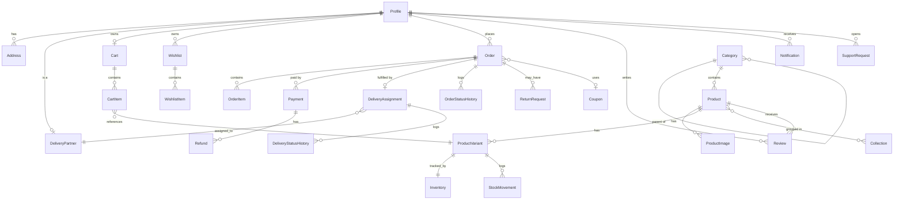

# Payantra — Architecture & Implementation Plan

## 1. System architecture

```
 Browser ──► Next.js (App Router, Vercel/Node)  ── RSC fetch / client fetch ──┐
    │            │  GSAP · Lenis · R3F · shadcn/ui                            │
    │            └─ Supabase JS (auth only: sign-in, session cookies)         ▼
    │                                                              Express API  /api/v1
    │  Razorpay Checkout.js                                  (Node 20+, TypeScript, Prisma)
    │        │                                                  │        │         │
    │        ▼                                                  ▼        ▼         ▼
    └──► Razorpay ── webhook (raw body + HMAC) ───────────►  AWS RDS   Supabase   Razorpay
                                                             Postgres   Auth JWKS   REST API
                                                             "payantra" (verify)    (orders/refunds)
```

### Trust boundaries
| Concern | Source of truth | Enforced by |
|---|---|---|
| Identity | Supabase Auth (JWT) | Express verifies JWT signature via Supabase JWKS |
| Role (`CUSTOMER`/`DELIVERY_PARTNER`/`ADMIN`) | `profiles.role` in RDS | `requireRole()` middleware; frontend role is display-only |
| Price, stock, discount, delivery fee | RDS rows | `pricing.service` on the server; client totals are never read |
| Payment outcome | Razorpay signature + webhook | `payment.service`; no code path marks "paid" without one |
| Ownership | `userId` FK on every owned row | service-layer `where: { id, userId }` |

### Key design decisions
1. **Two deployables, one repo.** `client/` (Next.js) and `server/` (Express). The browser talks to Express for all business data; Supabase is used by the browser only for authentication.
2. **Money is integer paise** (`Int`/`BigInt`) everywhere. Razorpay also uses paise, so no conversion bugs. Never `Float`.
3. **Order lifecycle is split into three independent state machines**: `paymentStatus`, `fulfilmentStatus`, and the per-assignment `deliveryStatus`. Each has a pure transition table that is unit tested.
4. **Stock uses reserve → commit/release.** Checkout reserves stock inside a transaction using `UPDATE ... SET reserved = reserved + n WHERE on_hand - reserved >= n` (atomic, no oversell). Payment capture commits; expiry job releases.
5. **Webhook idempotency** through a unique `WebhookEvent.eventId` row inserted in the same transaction as the state change.
6. **Order item snapshots**: name, SKU, unit price, tax, variant attributes copied at purchase time.
7. **Audit log** is written by a single `audit()` helper called inside admin service transactions.
8. **One rule-book for fulfilment.** Whoever moves an order forward — an admin's button or a delivery partner's action — goes through the same `moveOrder()` in `order-lifecycle.ts`, so dashboards cannot disagree. While a partner is on a job the hand-over steps belong to the partner (see [DELIVERY.md](DELIVERY.md)).
9. **Proof of delivery without a stored secret.** The customer's delivery code is derived from a server secret and the assignment, never written to the database ([DELIVERY.md](DELIVERY.md)).
10. **Reports are definitions, not hard-coded numbers.** Revenue, refunds and net are computed from `paidAt` / `processedAt` in India calendar days ([REPORTS.md](REPORTS.md)); the CSV is built from the same table the screen shows.

## 2. Repository layout

```
payantra-ecom/
├─ docs/                      ARCHITECTURE.md, API.md, DEPLOYMENT.md
├─ client/                    Next.js 15 App Router
│  └─ src/
│     ├─ app/
│     │  ├─ (marketing)/      landing page, story
│     │  ├─ (shop)/           shop, category, product, search, cart, checkout, wishlist
│     │  ├─ (auth)/auth/      login, register, forgot-password, callback
│     │  ├─ account/          customer dashboard
│     │  ├─ delivery/         partner dashboard
│     │  └─ admin/            admin dashboard
│     ├─ components/          ui/ (shadcn), layout/, product/, home/, three/
│     ├─ lib/                 api client, supabase, utils, motion (gsap/lenis)
│     ├─ services/            one module per API area
│     ├─ hooks/  stores/  types/
├─ server/                    Express + Prisma
│  ├─ prisma/                 schema.prisma, migrations/, seed.ts
│  └─ src/
│     ├─ config/              env (zod), logger, prisma, supabase, razorpay
│     ├─ middleware/          auth, rbac, validate, error, rateLimit
│     ├─ modules/<area>/      routes · controller · service · schema
│     ├─ lib/                 money, errors, pagination, stateMachines
│     ├─ app.ts  server.ts
│     └─ tests/
└─ .github/workflows/         ci.yml
```

## 3. Entity-relationship diagram



## 4. Implementation plan

| Phase | Scope | Exit criteria |
|---|---|---|
| **1 Foundation** ✅ | Monorepo, Prisma schema + first migration, Express skeleton (env, logging, security middleware, health, error handling), Supabase JWT verification, RBAC, Next.js scaffold, design tokens, CI | `npm run typecheck`, `npm test`, `GET /api/v1/health` returns DB status |
| **2 Auth + catalogue** ✅ | Profile sync, role management, categories, products, variants, search, filters; admin product/inventory CRUD; seed script; auth pages; shop/product pages; admin UI | Catalogue visible in `/shop` from DB; admin can create product |
| **3 Shopping + payments** ✅ | Cart, wishlist, addresses, coupons, checkout, Razorpay order/verify/webhook, stock reservation, refunds | Payment completes against the Razorpay stand-in; duplicate webhook is a no-op. *Live sandbox walk-through still to do — see PAYMENTS.md* |
| **4 Dashboards** ✅ | Customer (reviews, notifications, support, security), delivery partner (application → approval → code-verified delivery), admin (overview, reports + CSV, customers, partners, support, banners, newsletter, audit log) | Full order → delivery lifecycle in the browser suite (`e2e/`) |
| **5 Premium UI** | R3F hero, GSAP, Lenis, ReactBits, a11y and reduced-motion | Lighthouse perf ≥ 85 on mobile, no CLS |
| **6 Hardening** | Playwright E2E, security tests, deployment docs, CI/CD | CI green, docs complete |

## 5. Accounts you must create (cannot be automated)
- **Supabase project** — Project URL, anon key, JWT secret / JWKS URL, Google OAuth provider enabled.
- **AWS RDS PostgreSQL 16** — database `payantra`, security group allowing the server only.
- **Razorpay** — test Key ID / Key Secret, webhook secret (events: `payment.captured`, `payment.failed`, `refund.processed`).
